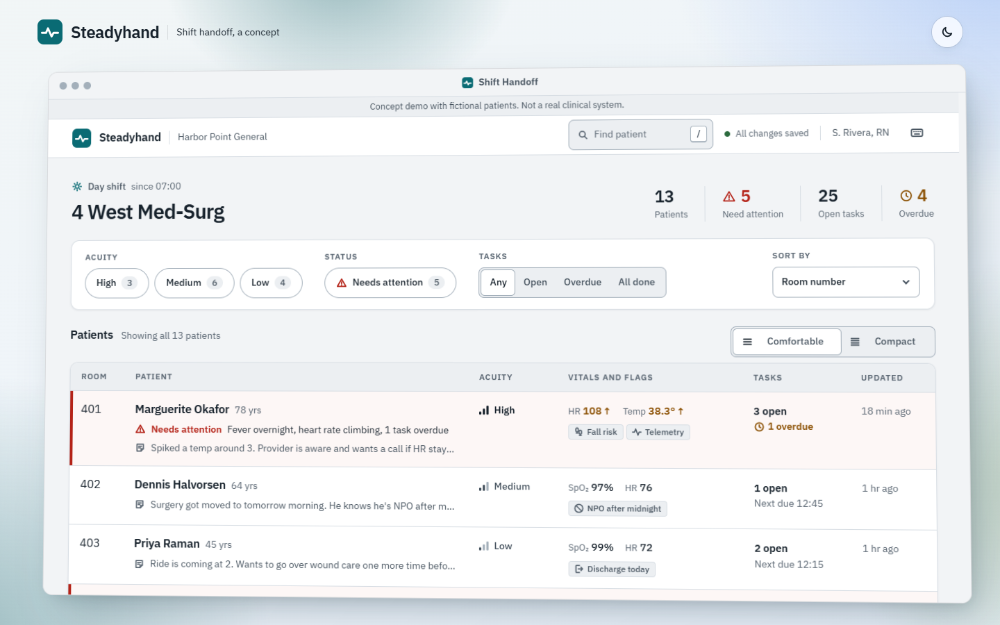

# Steadyhand: a shift handoff board (concept)

**Live demo: https://ederyc.github.io/Shift-Handoff-Demo/**



**This is a self-directed concept and practice project.** It isn't real software, it isn't deployed anywhere clinical, and it isn't affiliated with any healthcare company or product. There was no client and no user research. The hospital ("Harbor Point General"), the unit ("4 West Med-Surg"), the staff and all 13 patients are invented. The vitals are rounded on purpose and the "out of range" rules are deliberately simple. None of it is clinical guidance.

I built it to work through one UI problem: **how do you make a dense list stay calm and readable for someone who's busy, tired and under time pressure?**

The longer write-up, with the reasoning behind the decisions, is in [docs/CASE-STUDY.md](docs/CASE-STUDY.md).

## What's in it

- **Desktop window.** On wide screens the whole app lives in a floating "Shift Handoff" window on a branded backdrop, tilted slightly at rest. It lies flat while you work in it, because text on a tilted layer renders softer. Drag it by the title bar: it wobbles like jelly as you pick it up, follows the pointer 1:1, and when you let go it plops down and sends a ripple out across the backdrop like a stone dropped in water. Double-click the title bar to put it back. The wordmark (top left) and a sun/moon night mode button (top right) sit on the layer above the window; slide the window under the wordmark and a frosted backing fades in so it stays readable. Below 1360px wide (or 640px tall) the window steps aside, the app fills the screen as usual, and night mode goes back inside the app.
- **Roster board.** One row per patient: room, name, acuity, the two vitals most worth a glance, flags, open task count and last update. Rows reflow into cards on phones.
- **Filters and sort.** Acuity, "needs attention," task status and four sort orders. The list updates instantly, and rows glide to their new positions instead of snapping.
- **Density toggle.** Comfortable or compact rows. Compact drops the note preview and shows flags as icons, but never hides "needs attention." It remembers your choice.
- **Detail drawer.** Full vitals, flags, tasks, handoff notes and an activity log. Step to the previous or next patient without closing it.
- **Handoff notes.** A short note (280 characters max) for the next shift. The newest one becomes the preview line on the board.
- **Needs attention.** Driven by a recorded concern or any overdue task. Always icon, then text, then color, so it never depends on color alone.
- **Task check-off.** The one bit of delight: the box dips under the press, the check draws itself in, a soft ring breathes out once and the label gets struck through. About 200ms.
- **Activity log.** Append-only, like a real audit trail. Unchecking a task logs "reopened" instead of erasing the check-off.
- **Find patient.** `/` or `Ctrl K` opens a quick search by name or room.
- **Keyboard first.** Arrow keys or `J`/`K` move through the list, `[` and `]` step through patients in the drawer, `?` shows every shortcut.
- **Loading, saving and empty states.** A skeleton that matches the real rows, a global save indicator, a confirmation when a note saves, an empty-unit state and a "no matches" state that names the filters doing the excluding.
- **Night mode.** The same token system with a lower-luminance palette, and a deeper backdrop behind the window.

### Demo controls

The footer has buttons to replay the loading state, show the empty unit and reset the sample data. You can also deep link to `?state=empty` or `?state=loading`.

Changes save to `localStorage` in your browser. After 12 hours the demo seeds a fresh "shift" so the timestamps never go stale.

## Accessibility

- A semantic table for the roster, with explicit ARIA table roles so screen readers keep the table when rows reflow into cards on small screens.
- One `h1`, then `h2` for page regions and `h3` for drawer sections.
- The patient list is one Tab stop (a roving tabindex), with arrow keys inside it, instead of 13 stops in a row.
- The drawer and both small dialogs are native modal `<dialog>`s: the page behind goes inert, Escape closes them, Tab wraps inside them, and focus goes back to where you were. If that row got filtered out in the meantime, focus lands on the list heading instead.
- "Find patient" is an ARIA 1.2 combobox: focus stays in the field and the highlighted result is announced through `aria-activedescendant`.
- Every interactive element has a visible focus state, and every target is at least 44px, including compact rows.
- Every text and status color pairing passes WCAG AA in both themes.
- `prefers-reduced-motion` turns every transition, reorder, the check-off animation and the window's jelly, plop and ripple into instant changes (the ripple doesn't play at all).
- Dragging the window is pointer-only and entirely optional. The title bar is never a Tab stop and nothing in the app depends on where the window sits. When nothing is focused, Page Down, Space, Home and End scroll the window like a page.

## Quality checks

These are numbers I measured, not targets. Lighthouse 12.2.1 ran against a local static server with its default simulated throttling, three runs each.

| Lighthouse | Performance | Accessibility | Best practices | SEO |
| --- | --- | --- | --- | --- |
| Mobile (412px, plain app) | 96 | 100 | 100 | 100 |
| Desktop preset (1350px, plain app) | 100 | 100 | 100 | 100 |
| Desktop 1440px (in the window) | 100 | 100 | 100 | 100 |

Lighthouse's desktop preset emulates a 1350px screen, just under the window's breakpoint, so I added a 1440px run to measure the tilted, shadowed window itself. It loads with 0ms total blocking time and no layout shift. On mobile, first contentful paint is 1.5s and largest contentful paint 2.4s. The weak spot is still mobile total blocking time, 140ms to 170ms, mostly the browser's first layout of the board on a 4x slowed CPU. The live site may differ a little from these local runs.

Lighthouse only measures loading, so I also timed frames during the new motion (headless Chrome at 1440px, three runs). Dragging the window and the tilt-to-flat transition hold a median of 16.7ms per frame with the slowest 5% around 17ms. Scrolling inside the window has its slowest 5% at about 33ms, the same as scrolling the plain page without any window, so the window adds no measurable cost. Headless Chrome renders in software, so treat these as a stress test rather than a prediction for a real browser.

Beyond that I ran scripted checks in headless Chrome:
- a contrast audit of every visible piece of text against its real rendered background, across 13 states in both themes (0 failures in about 2,800 samples, lowest ratio 5.0:1), plus the wordmark against every backdrop color
- a Tab walk through the board, drawer and dialogs confirming every focus stop is visible
- keyboard, focus-return and reduced-motion checks for each interaction
- the window: 1:1 drag tracking, the jelly and plop shapes, the ripple (behind the window, never blocking clicks, cleaned up after), drag limits, touch, resizing, the fallback sizes, and dialogs painting above it

## Running it

There's no build step and no dependencies. Serve the folder with any static server:

```sh
npx serve .
# or
python -m http.server
```

Opening `index.html` straight from disk mostly works, but browsers won't load the self-hosted font from a `file://` page, so you'd get the system font instead (and a console warning about it).

To deploy, push to `main`, then go to **Settings → Pages** in the repo and set the source to "Deploy from a branch", `main`, `/ (root)`.

## Code tour

```
index.html         Markup, the desktop shell, the three dialogs, icon sprite
css/tokens.css     Every color, size, space, radius and duration, plus the status and backdrop color recipes
css/base.css       Font, reset, type roles, buttons, app chrome, filter controls
css/board.css      Roster table, row states, density, skeleton, empty states, mobile cards
css/drawer.css     Drawer, check-off animation, note form, activity log
css/overlays.css   Find patient and the shortcuts sheet
css/shell.css      The desktop window, backdrop and wordmark (wide screens only)
js/data.js         Seed data (invented), stored as minute offsets from "now"
js/store.js        State, localStorage, activity log, derived values, fake save latency
js/format.js       Escaping, time formatting, small markup helpers, flag icons
js/motion.js       Motion helpers that read the CSS motion tokens (FLIP, nudges, fades)
js/board.js        Renders the board's four states
js/modal.js        Shared open, close and focus handling for the small dialogs
js/drawer.js       Drawer rendering, next and previous, tasks, notes, activity
js/palette.js      Find patient
js/app.js          Filters, sorting, density, keyboard navigation, shortcuts, theme
js/shell.js        The window: flat while in use, dragging, keyboard scrolling
fonts/             IBM Plex Sans (Latin subset) and its license
```

It's plain HTML, CSS and JavaScript with no framework. The scripts are classic deferred scripts that share one `SH` namespace.

## Credits

Type is [IBM Plex Sans](https://github.com/IBM/plex), self-hosted under the SIL Open Font License (see `fonts/OFL.txt`). I drew the icons for this project.
