# Steadyhand: keeping a dense clinical list calm

*A self-directed concept piece. There was no client, no real users, no real patients and no research behind it. Everything below is my own reasoning, and the testing section is written as what I would test, not what I did test.*

**Live demo: https://ederyc.github.io/Shift-Handoff-Demo/**

## The problem

Picture a nurse picking up a unit at shift change. They need to know who's on the floor, who's getting worse, what's overdue and what the last shift wanted them to know. They need all of it in the first ten minutes, probably while someone is asking them something else.

That's a lot of data per person: a name, a room, acuity, vitals, flags, tasks and notes, times 13 patients. The easy move is to show all of it, and you end up with a wall of equally loud cells. The design problem I gave myself was narrower: **make a dense list that stays calm**, where the thing you need jumps out and everything else waits its turn.

## Constraints

- **It's a concept, not a product.** I'm not a nurse and I didn't talk to any. The workflow follows the general shape of handoff and rounding tools, and anything that sounds clinical is simplified on purpose. Precision wasn't the point, and fake data that's too precise starts to look like a real record.
- **One unit, one board, one drawer.** No orders, no charting, no meds and no navigation between units. Keeping the scope that tight is what let me spend the time on typography, states and interaction.
- **No framework, no backend.** Plain HTML, CSS and JS with `localStorage`. A filterable list, a drawer and a form don't need more than that, and staying small keeps it fast.
- **The accessibility bar was fixed from the start**, not a stretch goal: keyboard operable, AA contrast, 44px targets and reduced motion support.

## Process: structure before pixels

I started from questions, not layouts. The first pass was just a list of what someone walking onto the unit asks, in rough order:

1. Is anyone in trouble right now?
2. Who's the sickest overall?
3. What do I owe whom, and is any of it late?
4. What did the last shift want me to know?
5. When did someone last lay eyes on this person?

Each question became a column or a signal, and the order of the questions set the visual priority. That gave me a few rules before I opened a stylesheet:

- **"Needs attention" and "acuity" are different things.** A high acuity patient can be completely stable, and a low acuity patient can have an overdue blood sugar check. Mixing them up is how boards end up all red. Attention is about *right now*, so it gets the alert color. Acuity is a standing fact, so it stays neutral.
- **Attention is computed, not just typed in.** A patient needs attention if someone recorded a concern *or* any task has gone overdue. So finishing the overdue task can clear the flag, which turns out to matter a lot for the check-off moment.
- **The board answers questions 1 through 5. The drawer holds everything else.** If a piece of information doesn't help you decide where to walk next, it belongs in the drawer.
- **No navigation away from the board.** The drawer opens over it, and the board keeps updating behind it.

I built it in passes after that: a working v1, then an interaction pass, a visual depth pass, a feature pass and a final quality pass. Each pass had to keep everything the earlier ones got right.

## Key screens and decisions

### The roster

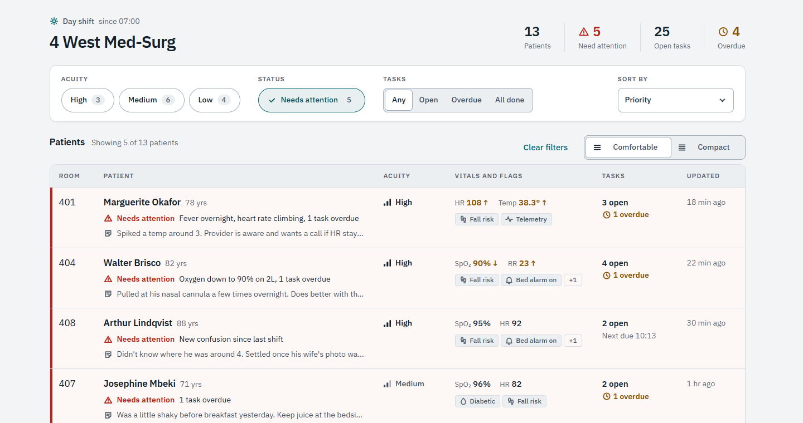

- **Attention is icon, then words, then color.** Every flagged row reads "⚠ Needs attention" followed by the reason in plain language. The red left rule and the faint tint come last. Someone with red-green color blindness, or a washed-out monitor at 3 AM, still gets the full message.
- **Red means one thing.** Alert red is only ever used for "needs attention." Overdue tasks and out-of-range vitals use amber, and acuity uses ink weight plus a three-bar glyph. When red is rare, it actually works.
- **The vitals column shows what's off.** Each row picks the two vitals most out of range and falls back to SpO₂ and heart rate. Abnormal values get an arrow, a screen reader "high" or "low," and amber.
- **Flags have shapes.** Every flag carries its own icon (a bell for bed alarm, a shield for contact precautions), so a row of flags can be scanned by shape before it's read.
- **Whitespace does the grouping.** Rows are split by one hairline and generous padding, not boxes. Inside the patient cell, the name, the attention line and the note preview have different weights and sizes, so they read as three layers instead of three equal lines.
- **Priority sort by default.** Attention first, then acuity, then room. "Longest since update" is there too, because "who hasn't anyone checked on?" is a real question.

### Density

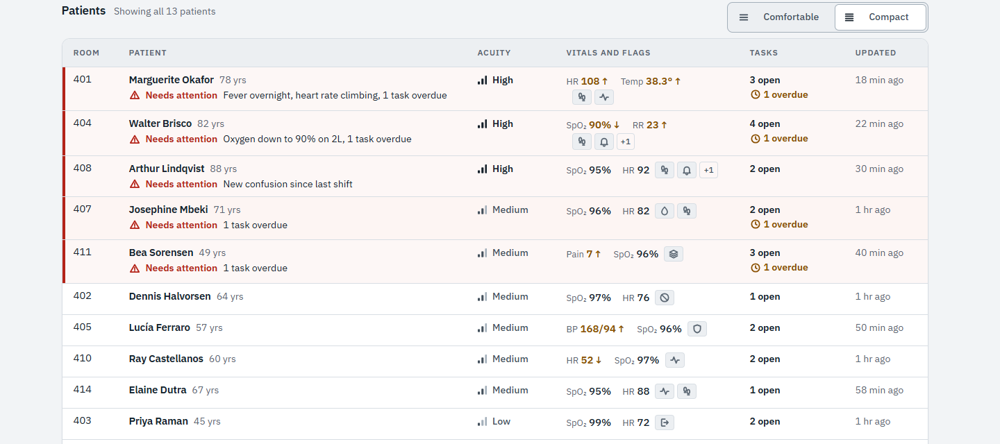

Comfortable is the default because it's calmer. But once you know the patients, a nurse would trade that calm for seeing the whole unit at once, so there's a compact mode. Deciding what compact gives up was the actual design work:

- The note preview goes first. It's the least time-critical line, and the full note is one click away.
- Flags go icon-only, with the name kept for screen readers and as a tooltip. This only works because the flags already had distinct icons.
- "Next due" goes. Overdue stays.
- **"Needs attention" never compresses.** Same icon, same words, same rule.
- Rows never drop below 44px, because the whole row is the tap target.

### Filters and empty states

- **Counts on every chip,** so you know what a filter will do before you press it. Selected chips also get a check mark, not just a color change.
- **It updates on every input, with no apply button.** Rows glide to their new positions (a FLIP animation), so you can see where things went instead of re-reading the list.
- **Two empty states, because they mean different things.** "No patients match these filters" names the filters doing the excluding and offers one way out. "No patients assigned yet" shows the shape of the board it's waiting to become, as faded "Open bed" rows.

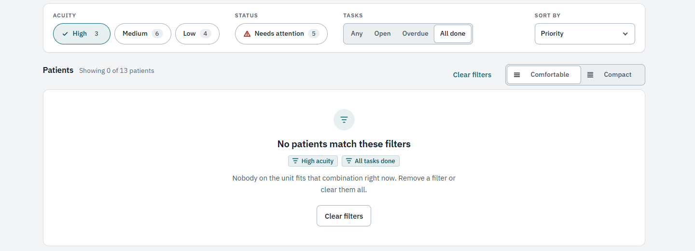

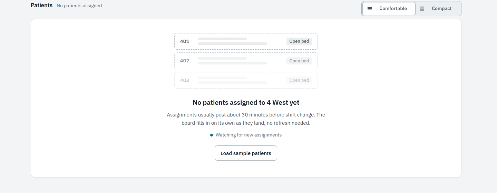

- **Loading looks like the board it's about to be.** Skeleton rows copy the real row's structure (name and age, note lines, vitals, flags), and one light sweep crosses the whole table instead of every bar shimmering on its own. The census numbers turn into placeholders too, instead of flashing stale values.

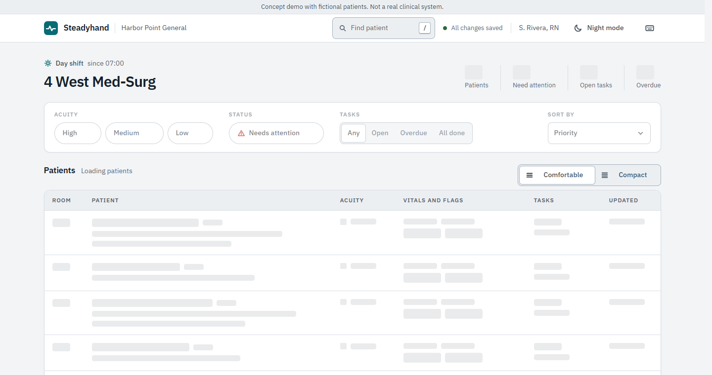

### The detail drawer

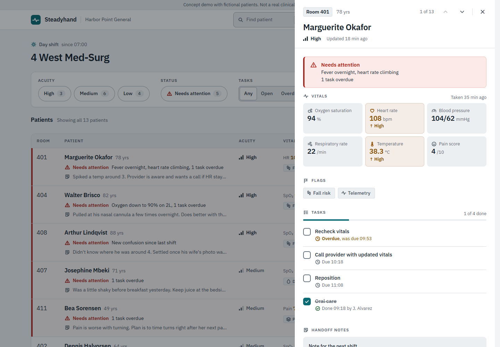

- **A native `<dialog>`**, so the page behind is truly inert and Escape works without extra code. I added a Tab wrap on top, and focus goes back to the row you came from. If that row has since been filtered out, focus lands on the list heading instead of falling back to the top of the page.
- **Attention sits at the top as a banner,** repeating the reasons from the board, so the drawer never contradicts the row you clicked.
- **Previous and next follow the board.** `[` and `]` (or the header arrows) step through patients in whatever order the board is showing, with a "3 of 13" counter. Rounding is a walk down the list, so closing and reopening the drawer for every patient was the friction worth removing.
- **Task order is frozen while the drawer is open.** Checked items don't jump to the bottom under your cursor.

### The one delight moment: checking off a task

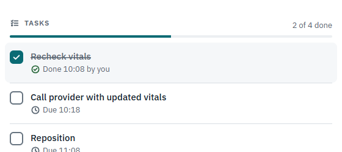

This is the bit I spent the most time on, because it's the whole thesis in one interaction: software for a stressful job can still feel good to use.

Pressing dips the box slightly. On release, in about 200ms, it fills with the accent color and settles back, the check draws itself in, a soft ring breathes out once, and a strike line sweeps across the label as it steps back to a quieter gray. The progress bar slides forward, the census count nudges, and the board behind re-sorts.

What I left out matters just as much: no bounce, no confetti, no sound, no toast. The context is serious, so the feedback is quick and then gets out of the way. If the task was the overdue one, the attention banner disappears at the same moment, which is honestly the most satisfying part. You see the problem go away.

That curve then became the system. The check-off's easing is the `--ease-settle` token, and everything that arrives or answers a press uses it: rows reordering, the drawer sliding in, the segmented controls, the dialogs. Things that leave use a faster `--ease-exit`. JS animations read the same tokens, so it all feels like one hand made it. With reduced motion, every one of these changes is instant.

### Handoff notes and the activity log

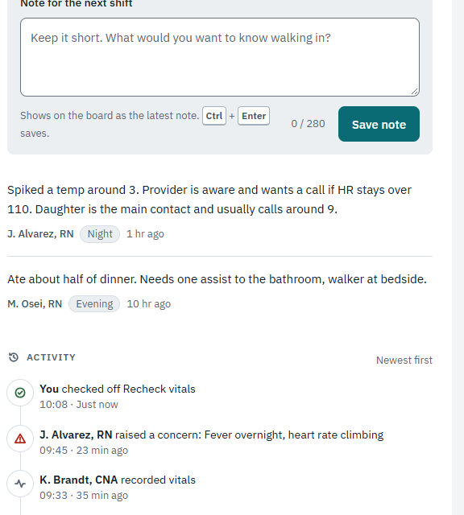

- **Notes are capped at 280 characters,** with a counter that turns amber near the limit. Handoff notes should be short, and the cap nudges people that way.
- **Notes aren't optimistic.** Check-offs show instantly and save in the background, but a note waits for its save to finish before it appears. A note that looks saved but isn't is the worst way for this to fail. When the save lands, the button briefly turns into a green "Saved."
- **The activity log is append-only.** Unchecking a task logs "reopened" instead of quietly erasing the "checked off" entry, because that's how a real record should behave.

### Getting around fast

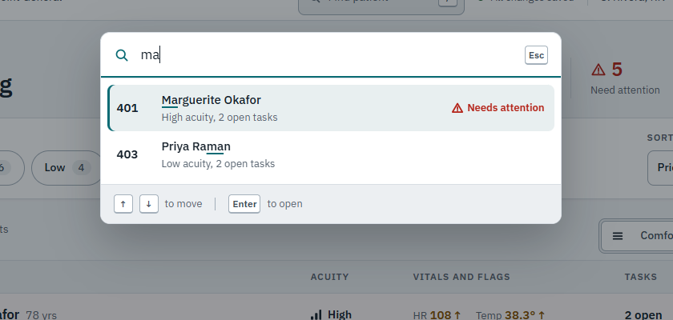

- **Find patient** (`/` or `Ctrl K`) matches names and rooms and ranks word-start matches first. It's an ARIA combobox, so a screen reader hears the highlighted result and the count.
- **The list is one Tab stop.** Arrow keys or `J`/`K` move inside it, rather than making keyboard users Tab through all 13 rows.
- **`?` shows every shortcut,** and so does a button in the header, because nobody guesses `?`.

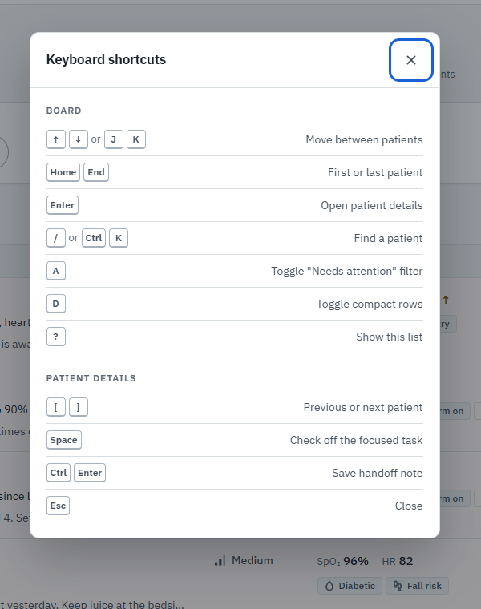

### The visual system

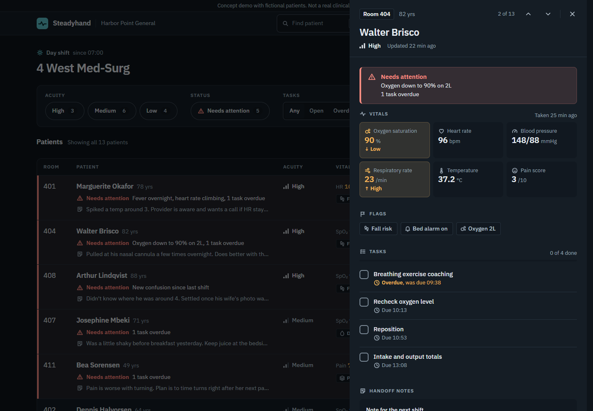

- **One label voice.** Table headers, filter legends and drawer sections all share a small uppercase overline style, so labels never compete with data.
- **Status colors come from a recipe.** Each status has one hand-picked hue per theme. Its tints, soft fills and borders are mixed from that hue with `color-mix()`, the same way in both themes, so night mode can't drift from day mode. Night mode exists because units run around the clock.
- **One icon set:** a single grid, round caps and two sizes, with non-scaling strokes so the line weight is identical at both sizes.

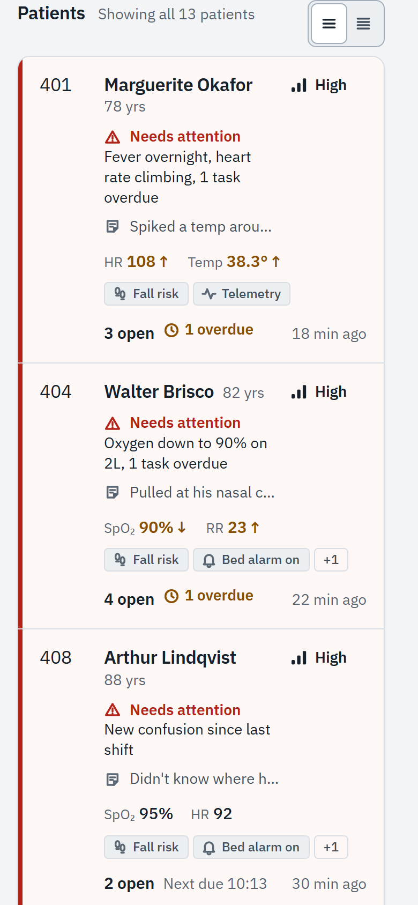

## Quality checks

These are measurements I took, not claims about real-world performance:

- **Lighthouse** (local static server, simulated throttling): mobile 95 performance, 100 accessibility, 100 best practices, 100 SEO; desktop 100 across the board. The weak spot is mobile total blocking time, at 110 to 210ms.
- Two fixes came straight out of Lighthouse:
  - **Self-hosting the font.** The page was waiting on a third-party font server before it could paint. Self-hosting it took mobile first paint from 2.7s to 1.4s.
  - **A layout shift I'd never seen.** The empty roster let the footer paint on screen for a moment, then the loading skeleton shoved it away. Reserving the space up front took layout shift to 0.
- **Contrast,** measured on the rendered page rather than on token pairs: about 2,800 text samples across 13 states in both themes, none below AA, lowest 5.0:1.
- **Keyboard:** a scripted Tab walk through the board, drawer and dialogs checks that every focus stop is visible. That walk caught a real bug: the drawer's focus trap was counting SVG icon elements as focusable, so Tab could escape it.

## What I'd test if this were real

I didn't test any of this with people. If I were to, these are the questions I'd want answered first:

1. **Can people find the patient who needs them in under five seconds?** I'd show the board briefly, hide it and ask who they'd see first. I'd compare the current attention treatment with a color-only version and with one using a separate status column.
2. **Is "needs attention" the right trigger?** Rolling overdue tasks into attention could be useful, or it could create alarm fatigue on a busy day. I'd want to watch how fast the flag stops meaning anything.
3. **Does the auto-picked vitals column help or confuse?** Showing different vitals per row is efficient, but it breaks the "same thing in the same place" rule. People might prefer fixed columns they can scan down.
4. **What does compact mode give up that people miss?** I guessed the note preview was the least important line. I'd want to see whether people turn compact on and then keep opening drawers to read notes.
5. **Does the check-off moment hold up on the fortieth task of a shift?** Delight that wears thin by hour ten is just noise.
6. **Accessibility with real assistive tech users,** not just automated checks and my own screen reader passes, especially the table to card reflow, the roving list and the combobox.

## What I'd change with more time

- **Animate rows leaving, not just arriving.** Filtered-out rows currently vanish while everything else glides. An exit animation would make filtering feel fully continuous.
- **Undo for check-offs.** Checkboxes can be unchecked, but a short "Undo" right after a mis-tap on a moving cart would be kinder than hunting for the task again.
- **Let time move the board.** Relative timestamps refresh every 30 seconds, but a task that crosses its due time only shows as overdue at the next re-render. A real board should flag it the moment it happens.
- **Bring the test scripts into the repo.** The Lighthouse runs, contrast audit and keyboard walks live in my scratch folder because they need a headless browser package, and I wanted the repo free of dependencies. With more time I'd add them as an optional dev setup with CI.
- **Chase down mobile blocking time.** Most of it is the browser's first layout of the table on a slowed CPU. I'd look at rendering fewer nodes up front.
- **Small honest gaps:** the shortcuts sheet says "Ctrl" even though Cmd works on a Mac, compact flag names rely on a hover tooltip that touch screens can't use, and opening the file straight from disk falls back to the system font.
- **And the ideas I'd explore next:** a "since you last looked" marker for rows that changed while you were away, and a print view, since a lot of handoff still happens on paper.
